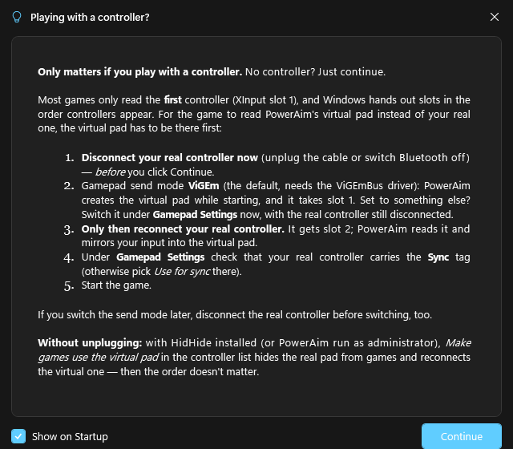

# Controller Overview

<video controls preload="none" playsinline poster="/videos/gamepad.jpg" src="/videos/gamepad.mp4" style="width:100%;border-radius:8px;margin:4px 0 16px"></video>

The controller manager on the **Gamepad settings** page shows **every controller in one list**: all
detected physical pads *and* PowerAim's virtual pad. That way you can see, at a glance, what Windows sees,
which device feeds the sync, and what each game will read.

<!-- SCREENSHOT NEEDED (../images/controller-overview.png): the controller list with a physical pad
     (Slot 1, "Sync" chip) and the virtual pad, each with a connected dot and slot/kind sub-text. -->

## What the list shows

Each row is one controller with:

- a **connected dot** (green = present, dimmed = remembered but not currently connected),
- its **name** (physical pads use their friendly name; the virtual pad is named by the active send
  mode: *Virtual (ViGEm)*, *(vJoy)*, *(XInput hook)* or *(internal)*),
- its **XInput slot** (Slot 1–4) when it's XInput-addressable,
- and tag chips for the current **Sync** source and a **Hidden** state.

Because XInput slots are the authoritative "connected gamepad" source, the list is built from the live
slots. A pad therefore shows up even on systems where the HID friendly-name enumeration comes back empty.

## Set the sync source

The **sync source** is the physical pad whose input is mirrored into the virtual pad (so the game,
reading the virtual one, still gets your real stick/buttons). Click **Use for sync** on any
XInput-addressable physical pad to make it the source. The choice is remembered across restarts.

## Hide a controller from games

When you drive the virtual pad, many games see **both** pads and sum their inputs. Hiding the physical
one fixes that:

- With **HidHide** installed, *Hide from games* cloaks the pad from every app **except PowerAim** (so
  PowerAim still reads it for the sync). This is the recommended path; see
  [Hidden Controllers](hidden-controllers).
- Without HidHide, PowerAim falls back to an **internal soft-hide** (it stops forwarding that pad). A
  note on the list tells you when only the internal hide is available.

The virtual pad itself can't be hidden.

## Connect in the right order

Windows hands out XInput slots in the order controllers appear, and most games only read the first
one. So the virtual pad has to exist before your real controller is plugged in. That is why PowerAim
shows this hint at startup, before it creates the virtual pad (untick **Show on Startup** to hide it):

1. Disconnect your real controller, then click **Continue**.
2. Leave the send mode on **ViGEm** (the default; needs the ViGEmBus driver). The virtual pad takes
   slot 1. If you use another mode, switch it on the Gamepad page while the pad is still unplugged.
3. Plug the controller back in: it gets slot 2 and is mirrored into the virtual pad.
4. Check that it carries the **Sync** tag in the list (or pick **Use for sync**), then start the game.

## Make games use the virtual pad

Games read the **lowest** XInput slot, and an app can't reassign slots (Windows hands them out by
arrival order). The **one-click helper** does the only thing that works: it removes the physical pad
from XInput (HidHide cloak, or a system disable when PowerAim runs **as administrator**) and
**reconnects the virtual pad** so it drops into the low slot the game reads first. A **Restore** action
undoes it. If neither HidHide nor elevation is available, PowerAim tells you which one to enable. The
internal soft-hide can't help here, because it doesn't remove the pad from XInput.

## Picking a controller elsewhere

The same control doubles as a **picker**. The [Gamepad Tester](gamepad-aim) uses it to
choose which controller's live state to visualize, so you can watch what PowerAim injects on the
virtual pad versus your own input on a physical one.

## Tips

- Set the sync source first, then use **make games use the virtual pad**. That order leaves the game
  reading the virtual pad while PowerAim still mirrors your real one into it.
- A dimmed row with a **Hidden** chip is a pad you've hidden before that isn't plugged in right now;
  it stays listed so you can always un-hide it.

## Troubleshooting

- **No physical pad in the list**: it must be XInput-addressable to show with a slot; DirectInput-only
  pads appear without a slot (and can't be a sync source). Press a button so Windows brings it up.
- **The virtual pad shows no slot**: in vJoy/internal modes it may not occupy a detectable XInput
  slot; it's still listed from the sender state.
- **"Make virtual primary" says it can't**: install HidHide or restart PowerAim as administrator; the
  internal soft-hide alone can't free the low slot.
